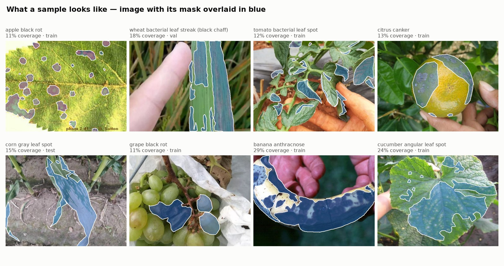
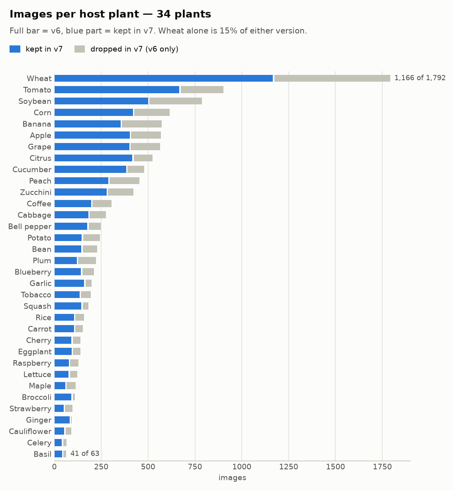
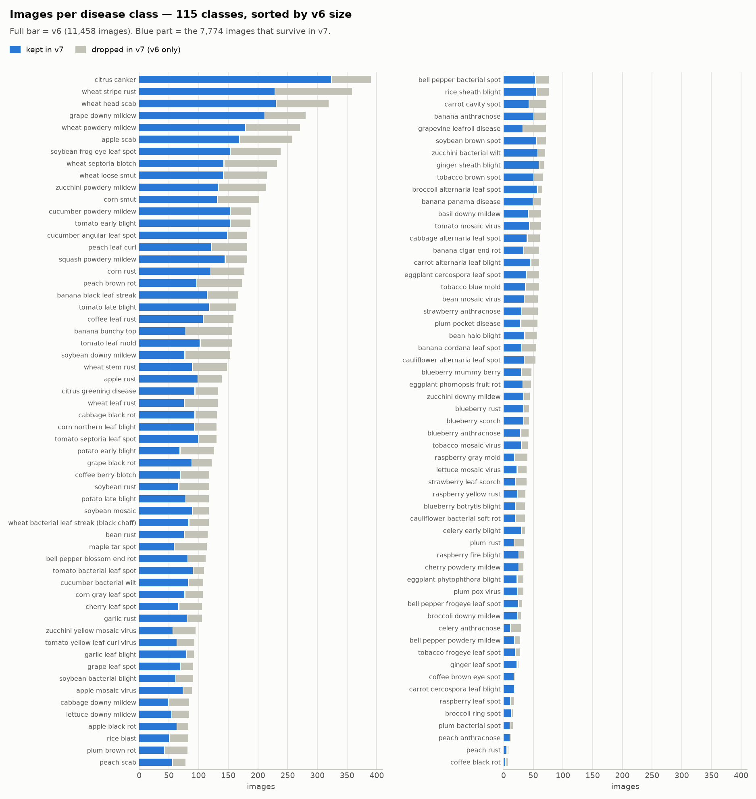
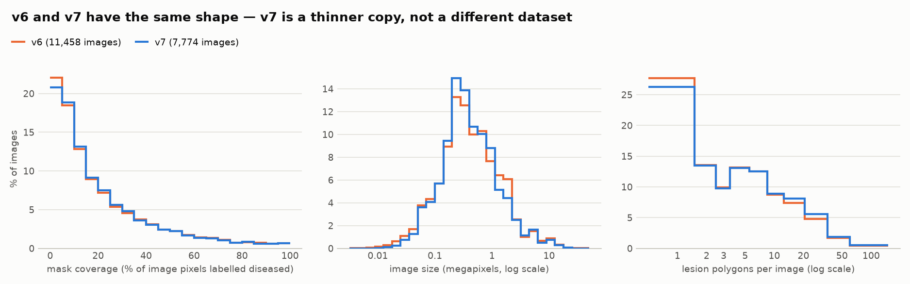
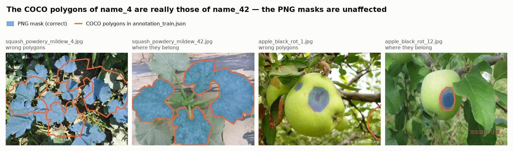

# PlantSeg v6 vs v7 — Dataset Statistics

> **Scope:** descriptive statistics for the two local copies of PlantSeg, [`data/plantseg-v6/`](../data/plantseg-v6/) and [`data/plantseg-v7/`](../data/plantseg-v7/), what changed between them, and the data-quality problems found along the way.
>
> *Computed on 2026-10-07 by decoding every image, mask and annotation file in both folders. Nothing in `data/` was modified. Method notes are in [section 7](#7-how-these-numbers-were-computed).*

## 1. Summary

**v7 is v6 with 3,684 images removed.** Nothing was added, and the 7,774 images that remain are byte-identical to their v6 copies, masks included. Every kept image stays in the same split. What did change is the metadata: source URLs, the licence field, and one class label that was wrong in v6.

| | v6 | v7 |
|---|---:|---:|
| Images (one mask each) | 11,458 | 7,774 |
| Train / val / test | 7,916 / 1,247 / 2,295 | 5,367 / 846 / 1,561 |
| Split shares | 69.1% / 10.9% / 20.0% | 69.0% / 10.9% / 20.1% |
| Host plants | 34 | 34 |
| Disease classes | 115 (Metadata lists only 114) | 115 |
| Lesion polygons in the COCO files | 77,394 | 77,394 listed, 55,814 usable |
| Mask coverage, mean / median | 21.4% / 13.7% | 21.4% / 13.9% |
| Median image | 667 × 534 px (0.37 MP) | 650 × 520 px (0.36 MP) |
| Smallest class | 7 images | 3 images |
| Licence field | CC0 10,325 · CC-BY 1,133 | CC-BY-NC 7,741 · CC0 33 |
| Size on disk | 1.8 GB | 1.1 GB |

Because v7 is a fairly even thinning of v6, the two versions are statistically the same dataset: same classes, same split proportions, same distributions of image size, mask coverage and lesions per image. The practical differences are the amount of data and how small the rare classes get.

Five things to know before training on either version:

1. **Use the PNG masks as ground truth, not the COCO polygons.** About 2% of images (3% of the training split) carry another image's polygons ([5.2](#52-coco-polygons-belong-to-a-different-image-for-about-200-images)), and v7's JSON files still list 21,580 annotations for images that were removed ([5.1](#51-v7-coco-files-still-list-annotations-for-removed-images)).
2. **Validation and test scores are optimistic.** In v7, 11.7% of test images and 12.6% of validation images have an identical or near-identical copy in train ([5.3](#53-duplicate-images-leak-across-splits)).
3. **Apply EXIF orientation when loading images.** A few images are stored rotated and their masks only line up after rotation ([5.6](#56-exif-rotated-images)).
4. **Class id = mask pixel value − 1 = COCO `category_id` = `Index` in Metadata.** The `categories` list in every COCO file is empty, so names must come from `Metadata.csv`.
5. **The classes are long-tailed and v7 makes the tail shorter.** In v7, 26 classes have fewer than 20 training images, one class has no test image and another has no validation image ([4.2](#42-classes)).

## 2. What is on disk

```
plantseg-v6/                                   plantseg-v7/
├── Metadata.csv        11,458 rows            ├── Metadata.csv        7,774 rows (UTF-8 with BOM)
├── images/{train,val,test}/*.jpg              ├── images/{train,val,test}/*.jpg
├── annotations/{train,val,test}/*.png         ├── annotations/{train,val,test}/*.png
└── json/annotation_{train,val,test}.json      └── annotation_{train,val,test}.json   ← moved to the root
```

Each sample is three things that share a file stem:

- **Image** `images/<split>/<stem>.jpg`. RGB, sizes vary widely (see [4.3](#43-image-properties)).
- **Mask** `annotations/<split>/<stem>.png`. 8-bit single-channel PNG, same size as the image, with two values: `0` for background and `Index + 1` for diseased tissue. Every image has exactly one disease class, so this is semantic segmentation with one foreground class per image.
- **Metadata row** in `Metadata.csv`, and a set of polygons in the split's COCO file.



`Metadata.csv` has the same ten columns in both versions:

| Column | Content | Checked against the files |
|---|---|---|
| `Name` | image file name | all present on disk, no extras, no duplicates |
| `Index` | class id, 0–114 | see [5.4](#54-label-noise) and [5.5](#55-v6-metadata-files-soybean-rust-under-bean-rust) |
| `Plant` | host plant, 34 values | |
| `Disease` | class name, 115 values | |
| `Resolution` | `WxH` | matches the stored image size for every row |
| `Label file` | mask file name | always `<stem>.png` |
| `Mask ratio` | fraction of pixels labelled diseased | matches the mask exactly for every row |
| `URL` | where the image came from | |
| `License` | licence tag | |
| `Split` | `Training` / `Validation` / `Test` | matches the folder for every row |

The COCO files hold `images` (`id`, `file_name`, `width`, `height`) and `annotations` (one polygon each, with `bbox`, `area`, `category_id`, `iscrowd = 0`). Image ids restart at 1 in each split file. In v7 the ids keep their v6 values, so they are no longer contiguous: the 5,367 train images have ids between 1 and 7,915.

Read v7's `Metadata.csv` with `encoding="utf-8-sig"`. It starts with a byte-order mark, and without that option the first column is named `Name`.

## 3. What changed from v6 to v7

| Change | Extent |
|---|---|
| Images removed | 3,684 of 11,458 (32.2%): 2,549 train, 401 val, 734 test |
| Images added | 0 |
| Kept images whose image or mask file differs | 0 of 7,774 (MD5 of both files compared) |
| Kept images that changed split | 0 |
| `License` rewritten | 7,741 rows: CC0 → CC-BY-NC (6,627) and CC-BY → CC-BY-NC (1,114); 33 rows stay CC0 |
| `URL` rewritten | 5,991 rows (77%); the host changed in 5,919 of them |
| `Disease` / `Index` corrected | 66 rows, soybean rust ([5.5](#55-v6-metadata-files-soybean-rust-under-bean-rust)) |
| COCO `images` lists | filtered to the kept images |
| COCO `annotations` lists | **not** filtered, identical to v6 ([5.1](#51-v7-coco-files-still-list-annotations-for-removed-images)) |
| JSON location | `json/` subfolder → dataset root |

The dataset ships no changelog, so the reason for the removal is inferred from which images went. The pattern points to a provenance and licensing clean-up rather than a quality filter:

- **Removal follows where an image came from.** Images whose file name carries a search-engine tag were removed far more often than the rest.

  | File-name tag | v6 | Removed | v7 |
  |---|---:|---:|---:|
  | `_google_` | 4,589 | 1,848 (40.3%) | 2,741 |
  | `_Bing_` | 3,269 | 1,260 (38.5%) | 2,009 |
  | `_Baidu_` | 700 | 106 (15.1%) | 594 |
  | no tag (plain number) | 2,900 | 470 (16.2%) | 2,430 |

- **It follows the old licence tag.** 35.5% of images tagged CC0 in v6 were removed, against 1.7% of those tagged CC-BY.
- **Stock-photo hosts were hit hardest.** 308 of 514 images (60%) whose v6 URL points to Alamy, Dreamstime, Shutterstock and similar sites are gone.
- **URLs became more specific.** Links that point straight to an image file rose from 534 (4.7%) to 4,198 (54%), and URLs shared by several images fell from 1,534 to 734.
- **Image content barely mattered.** Removed and kept images have nearly the same mask coverage (median 13.0% vs 13.9%) and size (median 0.41 vs 0.36 MP). The one visible content effect is that very small images were removed more often: 75% of those with a short side under 150 px (133 of 178).

Classes were thinned unevenly. Per-class retention averages 67% and runs from 38% (celery anthracnose, 29 → 11 images) to 95% (carrot cercospora leaf blight, 19 → 18). Class sizes keep almost the same ranking (Spearman ρ = 0.98), but stratification got looser: the train share per class was 68.7% ± 1.3 points in v6 and is 68.8% ± 4.3 points in v7.

## 4. Descriptive statistics

### 4.1 Splits

| Split | v6 images | v6 polygons | v6 coverage, mean / median | v7 images | v7 polygons (usable) | v7 coverage, mean / median |
|---|---:|---:|---:|---:|---:|---:|
| Train | 7,916 | 52,898 | 21.6% / 13.7% | 5,367 | 38,251 | 21.5% / 13.8% |
| Val | 1,247 | 8,927 | 20.3% / 13.4% | 846 | 6,460 | 20.5% / 13.5% |
| Test | 2,295 | 15,569 | 21.0% / 13.8% | 1,561 | 11,103 | 21.3% / 14.2% |
| **All** | **11,458** | **77,394** | **21.4% / 13.7%** | **7,774** | **55,814** | **21.4% / 13.9%** |

The three splits are statistically alike within each version: image size, coverage and lesions per image all have matching medians. v7's test set is a subset of v6's test set, so scores measured on one are not comparable with scores measured on the other.

### 4.2 Classes

There are 115 disease classes on 34 host plants, and each class belongs to exactly one plant. A plant has between 1 and 8 diseases (wheat 8, tomato 7, soybean 6, banana 6).



The ten largest plants hold 63% of v6 and 64% of v7. Wheat alone is 15.6% and 15.0%.



Images per disease class:

| | v6 all | v7 all | v7 train | v7 val | v7 test |
|---|---:|---:|---:|---:|---:|
| Smallest class | 7 | 3 | 2 | 0 | 0 |
| Lower quartile | 43 | 29 | 20 | 3 | 5 |
| Median | 78 | 55 | 38 | 6 | 11 |
| Mean | 99.6 | 67.6 | 46.7 | 7.4 | 13.6 |
| Upper quartile | 130 | 89 | 60 | 10 | 18 |
| Largest class | 390 | 323 | 225 | 33 | 65 |
| Largest ÷ smallest | 56× | 108× | 113× | – | – |
| Classes with < 20 images | 7 | 16 | 26 | 110 | 93 |
| Classes with ≥ 100 images | 46 | 21 | 11 | 0 | 0 |
| Gini coefficient | 0.39 | 0.40 | 0.41 | 0.41 | 0.41 |
| Effective number of classes (exp. entropy) | 89.8 | 87.9 | 87.6 | – | – |

The shape of the imbalance is the same in both versions (Gini 0.39 vs 0.40), but every class is smaller in v7 and the tail suffers most:

- **Largest in v7:** citrus canker 323, wheat head scab 230, wheat stripe rust 228, grape downy mildew 211, wheat powdery mildew 178.
- **Smallest in v7:** coffee black rot 3, peach rust 5, peach anthracnose 10, plum bacterial spot 10, celery anthracnose 11, raspberry leaf spot 11.
- **Coffee black rot has no test image in v7** (2 train, 1 val, 0 test) and **peach rust has no validation image** (4 train, 0 val, 1 test). In v6 every class appears in every split.
- With a median of 6 validation and 11 test images per class in v7, per-class IoU on most classes rests on a handful of images. Report macro averages with that in mind.

The full per-class table is in [Appendix A](#appendix-a-per-class-counts).

### 4.3 Image properties

| | v6 | v7 |
|---|---:|---:|
| Width, median (5th–95th percentile) | 667 px (250–1,920) | 650 px (295–1,920) |
| Height, median (5th–95th percentile) | 534 px (214–1,707) | 520 px (227–1,671) |
| Megapixels, median / mean | 0.37 / 0.91 | 0.36 / 0.85 |
| Smallest image | 69 × 52 | 120 × 90 |
| Largest image | 8,256 × 5,504 (45 MP) | 6,000 × 4,000 (24 MP) |
| Distinct resolutions | 5,709 | 3,895 |
| Aspect ratio w/h, median | 1.33 | 1.33 |
| Landscape / portrait / square | 71.3% / 25.3% / 3.4% | 74.2% / 22.2% / 3.6% |
| Short side under 224 px | 785 (6.9%) | 373 (4.8%) |
| File size, median | 65 KB | 63 KB |

| Long side | v6 | v7 |
|---|---:|---:|
| under 256 px | 453 (4.0%) | 197 (2.5%) |
| 256–511 px | 2,431 (21.2%) | 1,686 (21.7%) |
| 512–1,023 px | 4,769 (41.6%) | 3,504 (45.1%) |
| 1,024–2,047 px | 3,184 (27.8%) | 1,975 (25.4%) |
| 2,048 px or more | 621 (5.4%) | 412 (5.3%) |

These are web images, so there is no standard resolution: pixel counts span three to four orders of magnitude and no single resolution covers more than 2% of either version. Two thirds of the images have a long side under 1,024 px, so a 512 or 1,024 px training resolution upsamples a large part of the data.

Channel statistics on the training split, pixel-weighted and scaled to 0–1:

| | R | G | B |
|---|---:|---:|---:|
| v6 train mean | 0.445 | 0.493 | 0.336 |
| v6 train std | 0.245 | 0.230 | 0.242 |
| v7 train mean | 0.447 | 0.496 | 0.337 |
| v7 train std | 0.240 | 0.226 | 0.238 |
| ImageNet mean, for reference | 0.485 | 0.456 | 0.406 |

The data is greener and less blue than ImageNet, as expected for foliage.

### 4.4 Mask properties

"Coverage" is the share of an image's pixels labelled as diseased, the `Mask ratio` column.

| | v6 | v7 |
|---|---:|---:|
| Coverage, mean ± std | 21.4% ± 21.3 | 21.4% ± 21.0 |
| Coverage, median (25th–75th percentile) | 13.7% (5.7–30.2) | 13.9% (5.9–29.9) |
| Coverage, 5th / 95th percentile | 1.4% / 68.7% | 1.5% / 67.8% |
| Diseased pixels over the whole dataset | 19.5% | 19.4% |
| Background : diseased pixels | 4.1 : 1 | 4.2 : 1 |
| Separate regions per mask, mean / median | 6.9 / 3 | 7.3 / 4 |
| Masks with a single region | 3,143 (27.4%) | 2,019 (26.0%) |
| Masks touching the image border | 5,256 (45.9%) | 3,676 (47.3%) |
| Empty masks | 0 | 0 |

| Coverage | v6 | v7 |
|---|---:|---:|
| under 1% | 380 (3.3%) | 232 (3.0%) |
| 1–5% | 2,144 (18.7%) | 1,386 (17.8%) |
| 5–10% | 2,116 (18.5%) | 1,464 (18.8%) |
| 10–25% | 3,316 (28.9%) | 2,317 (29.8%) |
| 25–50% | 2,204 (19.2%) | 1,519 (19.5%) |
| 50–75% | 894 (7.8%) | 584 (7.5%) |
| over 75% | 404 (3.5%) | 272 (3.5%) |

Coverage is strongly right-skewed: about 40% of images have under 10% diseased pixels, while a few percent are almost entirely diseased. It also depends heavily on the disease. Mean coverage per class in v7 runs from 3.9% (bell pepper frogeye leaf spot) and 4.0% (bell pepper bacterial spot) up to 57.0% (soybean rust) and 69.6% (tobacco mosaic virus). Spot diseases tend to be annotated lesion by lesion, while rusts, mildews and viruses tend to be annotated as whole leaves. Diseased regions sit in the centre of the frame on average (mean centroid at 50% of the width and 51% of the height), yet almost half of the masks reach the border.



### 4.5 Lesion polygons

These numbers come from the COCO files and, for v7, count only annotations whose image is still present.

| | v6 | v7 |
|---|---:|---:|
| Polygons | 77,394 | 55,814 |
| Per image, mean / median | 6.8 / 3 | 7.2 / 4 |
| Per image, 95th percentile / max | 24 / 140 | 26 / 135 |
| Images with 1 polygon | 3,176 (27.7%) | 2,042 (26.3%) |
| Images with 2–5 | 4,198 (36.6%) | 2,820 (36.3%) |
| Images with 6–20 | 3,287 (28.7%) | 2,295 (29.5%) |
| Images with 21–50 | 703 (6.1%) | 542 (7.0%) |
| Images with more than 50 | 93 (0.8%) | 74 (1.0%) |
| Polygon area, median | 1,138 px² (0.26% of the image) | 1,036 px² (0.25% of the image) |
| COCO small (< 32²) / medium / large (> 96²) | 48.3% / 31.0% / 20.8% | 49.8% / 30.8% / 19.4% |
| Vertices per polygon, mean / max | 18.4 / 54 | 18.7 / 54 |

Half of all lesions are "small" by the COCO definition, and the median lesion covers a quarter of a percent of its image. Instance-level methods (detection, SAM-style box or point prompts) face a mostly small-object problem, even though the average mask covers a fifth of the image.

## 5. Data-quality findings

Ordered roughly by how much damage each can do. Every affected file is listed in [`plantseg-stats/flagged-files.csv`](plantseg-stats/flagged-files.csv) with the issue and an `in_v7` column.

### 5.1 v7 COCO files still list annotations for removed images

In v7 the `images` list of each COCO file was cut down to the kept images, but the `annotations` list was left exactly as in v6.

| File | Images | Annotations listed | Pointing at a removed image |
|---|---:|---:|---:|
| `annotation_train.json` | 5,367 | 52,898 | 14,647 |
| `annotation_val.json` | 846 | 8,927 | 2,467 |
| `annotation_test.json` | 1,561 | 15,569 | 4,466 |
| Total | 7,774 | 77,394 | 21,580 (27.9%) |

Code that walks the annotations and looks up each `image_id` will fail or count instances that do not exist. Drop every annotation whose `image_id` is not in `images` before use.

### 5.2 COCO polygons belong to a different image for about 200 images

When the polygons are rasterised and compared with the PNG mask, they agree for most images (median IoU 0.975). For a group of images they do not overlap at all, and in every one of those cases the polygons fit the mask of another image whose name starts with the same characters: `apple_scab_4` carries the polygons of `apple_scab_44`, `apple_black_rot_1` those of `apple_black_rot_12`. This looks like a file lookup by name prefix in the script that built the COCO files.



| | v6 | v7 |
|---|---:|---:|
| Images with another image's polygons (confirmed) | 214 | 180 |
| by split, train / val / test | 192 / 6 / 16 | 163 / 5 / 12 |
| Polygons disagree with the mask, no donor found | 6 | 6 |
| Images whose boxes extend past the image edge | 63 | 51 |
| Image with a mask but no polygon at all | 1 | 1 |

The PNG masks are correct in these cases: checked by eye on the examples above, the mask sits on the lesions and the polygons do not. In v7 this affects 3.0% of the training images, and for 19 of them the donor image no longer exists in v7. Another 261 v7 images (387 in v6) have a polygon-to-mask IoU between 0.5 and 0.9, which is a partial disagreement and not this bug.

This matters most for anything trained on boxes or instance polygons, including the SAM 3 fine-tuning described in [`sam3-guide.md`](sam3-guide.md). Either drop the flagged images or rebuild the instances from the PNG masks.

### 5.3 Duplicate images leak across splits

The images were collected from web searches, and the same photo was often collected more than once. Two kinds of duplicate were counted: exact (identical decoded pixels) and near (the same photo re-encoded, resized or watermarked, found with a perceptual hash).

| | v6 | v7 |
|---|---:|---:|
| Exact-duplicate groups / files in them | 387 / 791 | 267 / 546 |
| Clusters, exact + near | 820 | 601 |
| Images in a cluster | 1,768 (15.4%) | 1,294 (16.6%) |
| Redundant copies | 948 (8.3%) | 693 (8.9%) |
| Clusters spanning more than one split | 408 | 295 |
| **Val images with a copy in train** | 148 of 1,247 (11.9%) | **107 of 846 (12.6%)** |
| **Test images with a copy in train** | 251 of 2,295 (10.9%) | **183 of 1,561 (11.7%)** |
| of which exact copies, val / test | 60 / 114 | 37 / 80 |

v7 did not address this; its duplicate rate is slightly higher than v6's. More than one test image in ten has been seen during training, so test scores overstate generalisation. These figures are a lower bound, because cropped or mirrored copies are not detected.

In `flagged-files.csv` the clusters are numbered on v6. A v7 image counts as duplicated in v7 only when another file of its cluster also has `in_v7 = yes`.

### 5.4 Label noise

**The same photo filed under two diseases.** 179 duplicate clusters in v7 (398 images, 5.1% of the dataset) contain images from different classes; in v6 it is 216 clusters and 478 images. The most frequent pairs are the same pathogen on related hosts, where both search queries returned the same photo:

- cabbage alternaria leaf spot ↔ cauliflower alternaria leaf spot
- cucumber powdery mildew ↔ squash powdery mildew
- potato early blight ↔ tomato early blight
- coffee berry blotch ↔ coffee brown eye spot
- ginger sheath blight ↔ rice sheath blight

**Two annotators, two masks.** Exact duplicates were annotated independently (only 3 duplicate groups share an identical mask), which gives a direct measurement of annotation consistency. Across 282 pairs of masks drawn for the same image under the same class, the mean IoU is 0.79 and the median 0.84; 25 pairs (9%) fall below 0.5. Treat roughly 0.8 IoU as the level at which model error and annotator disagreement become hard to tell apart.

**Mask class differs from the metadata class.** For a few images the mask value and COCO `category_id` name one disease while the file name and `Metadata.csv` name another. Most are one position apart in the class list, which looks like a mis-click in the annotation tool. If class ids are read from mask values, these images get the wrong class.

| File | Split | In v7 | Metadata class | Mask / COCO class |
|---|---|---|---|---|
| `bean_mosaic_virus_23` | train | yes | bean mosaic virus (12) | rice blast (81) |
| `blueberry_mummy_berry_Bing_0058` | train | yes | blueberry mummy berry (20) | blueberry rust (21) |
| `broccoli_alternaria_leaf_spot_Bing_0012` | train | yes | broccoli alternaria leaf spot (23) | broccoli downy mildew (24) |
| `broccoli_alternaria_leaf_spot_Bing_0021` | test | yes | broccoli alternaria leaf spot (23) | broccoli downy mildew (24) |
| `broccoli_alternaria_leaf_spot_Bing_0023` | test | no | broccoli alternaria leaf spot (23) | broccoli downy mildew (24) |
| `broccoli_alternaria_leaf_spot_Bing_0035` | train | yes | broccoli alternaria leaf spot (23) | broccoli downy mildew (24) |
| `broccoli_alternaria_leaf_spot_Bing_0039` | train | yes | broccoli alternaria leaf spot (23) | broccoli downy mildew (24) |
| `broccoli_alternaria_leaf_spot_Bing_0045` | test | yes | broccoli alternaria leaf spot (23) | broccoli downy mildew (24) |
| `broccoli_alternaria_leaf_spot_Bing_0054` | test | yes | broccoli alternaria leaf spot (23) | broccoli downy mildew (24) |
| `citrus_canker_96` | test | no | citrus canker (38) | citrus greening disease (39) |
| `cucumber_powdery_mildew_google_0067` | train | yes | cucumber powdery mildew (50) | cucumber angular leaf spot (48) |
| `eggplant_phomopsis_fruit_rot_Bing_0015` | train | yes | eggplant phomopsis fruit rot (52) | eggplant phytophthora blight (53) |
| `eggplant_phomopsis_fruit_rot_Bing_0113` | train | no | eggplant phomopsis fruit rot (52) | eggplant phytophthora blight (53) |
| `ginger_leaf_spot_17` | train | yes | ginger leaf spot (56) | ginger sheath blight (57) |
| `tomato_leaf_mold_google_0110` | train | no | tomato leaf mold (99) | tomato mosaic virus (100) |
| `wheat_head_scab_Bing_0287` | test | yes | wheat head scab (104) | wheat leaf rust (105) |

That is 16 images in v6 and 12 in v7.

### 5.5 v6 metadata files soybean rust under bean rust

In v6's `Metadata.csv`, all 118 `soybean_rust_*` images are listed as plant `Soybean`, disease `bean rust`, `Index` 13. Their masks and COCO annotations use class 88. As a result v6's metadata has only 114 distinct diseases and no row with `Index` 88, and "bean rust" appears to have 233 images when it has 115.

v7 corrects this: the 66 surviving images are `soybean rust`, `Index` 88. When using v6, take the class from the mask value or the file name, or apply the same fix. All per-class numbers in this document use the corrected labels for both versions.

### 5.6 EXIF-rotated images

Fifteen images in v6 and nine in v7 are stored with an EXIF orientation flag (rotate 90° for all but one, which is 180°). Their masks and polygons are drawn in the rotated, as-displayed frame, while `Resolution` in the metadata and `width` / `height` in the COCO files describe the unrotated file.

A loader that ignores EXIF, such as plain `PIL.Image.open`, gets a size mismatch between image and mask for the 90° cases and a silently upside-down mask for the 180° case (`broccoli_downy_mildew_google_0005`, in v7 train). Use `PIL.ImageOps.exif_transpose(img)` after opening. `cv2.imread` applies the orientation by default.

### 5.7 Smaller oddities

| Issue | v6 | v7 | Note |
|---|---:|---:|---|
| `categories` list empty in the COCO files | all 3 files | all 3 files | take names from `Metadata.csv` |
| PNG data saved with a `.jpg` extension | 5 | 5 | decodes normally with PIL and OpenCV |
| MPO (multi-picture JPEG) files | 3 | 1 | decodes normally |
| Greyscale image | 1 | 1 | `grape_downy_mildew_google_0180`; convert to RGB on load |
| Mask covering 100% of the image | 2 | 1 | `coffee_leaf_rust_google_0136` (both), `corn_rust_41` (v6) |
| Mask with almost nothing in it | 1 | 1 | `apple_black_rot_google_0001`: 7 foreground pixels, no COCO polygon |
| Corrupt or unreadable files | 0 | 0 | |
| Images without a mask, or masks without an image | 0 | 0 | |

## 6. Choosing a version and loading it safely

**Which version.** Prefer v7 when the results will be shared or compared with other work: it is the later release, its metadata is correct, and its source and licence fields were revised. Prefer v6 only when the extra 47% of data matters more than that. Scores from the two versions are not comparable, since v7's test set is a 1,561-image subset of v6's.

**Loading checklist**, for either version:

1. Read the class from `Metadata.csv` (v7), or from the mask value minus one (v6). Build the id-to-name table from v7's metadata, since the COCO `categories` are empty.
2. Take segmentation ground truth from the PNG masks. For binary lesion segmentation, use `mask > 0`.
3. Call `ImageOps.exif_transpose` on every image and convert to RGB.
4. If instances are needed, filter orphan annotations in v7 and exclude the images flagged `coco_polygons_wrong`, or regenerate instances from the masks by connected components.
5. For an honest test score, remove from train every image that shares a duplicate cluster with a val or test image. That costs a few hundred training images.
6. Expect a 4 : 1 background-to-lesion pixel ratio and a long-tailed class distribution; use class-balanced sampling or a weighted loss, and report macro-averaged metrics next to pixel-level ones.

## 7. How these numbers were computed

- **Coverage of the data.** All 19,232 image and mask pairs across both versions were opened and fully decoded with Pillow; all six COCO files and both metadata files were parsed. No sampling.
- **Identity between versions.** MD5 of the file bytes and of the decoded pixel array, for both image and mask.
- **Image sizes** are the stored pixel dimensions, before any EXIF rotation.
- **Mask regions** are 8-connected components (SciPy `ndimage.label`).
- **Polygon checks.** Each image's polygons were rasterised with Pillow and compared with its PNG mask by IoU. For images with IoU under 0.5, the polygons were also compared with the masks of all other images that have the same bounding box, to find the donor.
- **Near-duplicates.** 256-bit difference hash on a 17 × 16 greyscale thumbnail; two images count as near-duplicates when their hashes differ in at most 40 bits and their aspect ratios are within 3%. 36 pairs sampled across the weaker matches were inspected by eye, and all 36 were the same photograph. Exact and near pairs were merged into clusters.
- **Imbalance measures.** Gini coefficient over images per class; effective number of classes is the exponential of the Shannon entropy of the class distribution.
- **Kept vs removed comparisons** use v6 values for both groups.

## Appendix A: Per-class counts

`Idx` is the class id: `Index` in `Metadata.csv`, `category_id` in the COCO files, and mask pixel value minus one. Counts use the corrected soybean rust labels for v6. "Kept" is v7 ÷ v6. Mean coverage is the average `Mask ratio` of the class in v7.

| Idx | Plant | Disease | v6 | v7 | Kept | v7 train / val / test | v7 mean coverage |
|---:|---|---|---:|---:|---:|---|---:|
| 0 | Apple | apple black rot | 83 | 63 | 76% | 43 / 8 / 12 | 15.9% |
| 1 | Apple | apple mosaic virus | 89 | 73 | 82% | 52 / 8 / 13 | 22.2% |
| 2 | Apple | apple rust | 139 | 98 | 71% | 64 / 12 / 22 | 13.0% |
| 3 | Apple | apple scab | 258 | 168 | 65% | 115 / 18 / 35 | 9.6% |
| 4 | Banana | banana anthracnose | 71 | 50 | 70% | 35 / 6 / 9 | 22.5% |
| 5 | Banana | banana black leaf streak | 167 | 114 | 68% | 79 / 10 / 25 | 47.2% |
| 6 | Banana | banana bunchy top | 157 | 78 | 50% | 56 / 9 / 13 | 12.6% |
| 7 | Banana | banana cigar end rot | 60 | 33 | 55% | 22 / 2 / 9 | 12.6% |
| 8 | Banana | banana cordana leaf spot | 55 | 30 | 55% | 19 / 3 / 8 | 31.7% |
| 9 | Banana | banana panama disease | 63 | 49 | 78% | 33 / 6 / 10 | 17.4% |
| 10 | Basil | basil downy mildew | 63 | 41 | 65% | 28 / 3 / 10 | 16.4% |
| 11 | Bean | bean halo blight | 56 | 35 | 62% | 24 / 5 / 6 | 15.1% |
| 12 | Bean | bean mosaic virus | 58 | 34 | 59% | 20 / 4 / 10 | 36.4% |
| 13 | Bean | bean rust | 115 | 75 | 65% | 54 / 7 / 14 | 55.4% |
| 14 | Bell pepper | bell pepper bacterial spot | 76 | 53 | 70% | 34 / 8 / 11 | 4.0% |
| 15 | Bell pepper | bell pepper blossom end rot | 112 | 81 | 72% | 54 / 11 / 16 | 8.9% |
| 16 | Bell pepper | bell pepper frogeye leaf spot | 31 | 24 | 77% | 16 / 3 / 5 | 3.9% |
| 17 | Bell pepper | bell pepper powdery mildew | 28 | 18 | 64% | 12 / 2 / 4 | 20.9% |
| 18 | Blueberry | blueberry anthracnose | 42 | 28 | 67% | 21 / 3 / 4 | 12.7% |
| 19 | Blueberry | blueberry botrytis blight | 36 | 19 | 53% | 13 / 3 / 3 | 7.8% |
| 20 | Blueberry | blueberry mummy berry | 47 | 29 | 62% | 20 / 4 / 5 | 12.2% |
| 21 | Blueberry | blueberry rust | 43 | 33 | 77% | 21 / 3 / 9 | 16.9% |
| 22 | Blueberry | blueberry scorch | 43 | 33 | 77% | 22 / 5 / 6 | 11.5% |
| 23 | Broccoli | broccoli alternaria leaf spot | 65 | 56 | 86% | 39 / 6 / 11 | 15.3% |
| 24 | Broccoli | broccoli downy mildew | 29 | 23 | 79% | 18 / 2 / 3 | 23.3% |
| 25 | Broccoli | broccoli ring spot | 16 | 12 | 75% | 7 / 2 / 3 | 16.2% |
| 26 | Cabbage | cabbage alternaria leaf spot | 61 | 39 | 64% | 24 / 6 / 9 | 27.6% |
| 27 | Cabbage | cabbage black rot | 131 | 93 | 71% | 63 / 11 / 19 | 11.6% |
| 28 | Cabbage | cabbage downy mildew | 84 | 49 | 58% | 34 / 5 / 10 | 19.1% |
| 29 | Carrot | carrot alternaria leaf blight | 60 | 45 | 75% | 32 / 6 / 7 | 14.1% |
| 30 | Carrot | carrot cavity spot | 72 | 42 | 58% | 29 / 4 / 9 | 10.5% |
| 31 | Carrot | carrot cercospora leaf blight | 19 | 18 | 95% | 13 / 1 / 4 | 11.7% |
| 32 | Cauliflower | cauliflower alternaria leaf spot | 54 | 34 | 63% | 27 / 3 / 4 | 18.1% |
| 33 | Cauliflower | cauliflower bacterial soft rot | 36 | 19 | 53% | 12 / 3 / 4 | 28.1% |
| 34 | Celery | celery anthracnose | 29 | 11 | 38% | 7 / 1 / 3 | 5.3% |
| 35 | Celery | celery early blight | 36 | 29 | 81% | 22 / 2 / 5 | 7.6% |
| 36 | Cherry | cherry leaf spot | 106 | 66 | 62% | 46 / 8 / 12 | 10.9% |
| 37 | Cherry | cherry powdery mildew | 33 | 25 | 76% | 16 / 3 / 6 | 25.3% |
| 38 | Citrus | citrus canker | 390 | 323 | 83% | 225 / 33 / 65 | 8.8% |
| 39 | Citrus | citrus greening disease | 133 | 93 | 70% | 66 / 9 / 18 | 11.8% |
| 40 | Coffee | coffee berry blotch | 118 | 69 | 58% | 47 / 7 / 15 | 5.0% |
| 41 | Coffee | coffee black rot | 7 | 3 | 43% | 2 / 1 / 0 | 22.0% |
| 42 | Coffee | coffee brown eye spot | 20 | 17 | 85% | 11 / 2 / 4 | 6.1% |
| 43 | Coffee | coffee leaf rust | 159 | 107 | 67% | 75 / 11 / 21 | 19.6% |
| 44 | Corn | corn gray leaf spot | 107 | 76 | 71% | 49 / 10 / 17 | 26.6% |
| 45 | Corn | corn northern leaf blight | 130 | 92 | 71% | 65 / 9 / 18 | 10.9% |
| 46 | Corn | corn rust | 177 | 120 | 68% | 84 / 13 / 23 | 40.3% |
| 47 | Corn | corn smut | 202 | 131 | 65% | 91 / 14 / 26 | 22.0% |
| 48 | Cucumber | cucumber angular leaf spot | 182 | 148 | 81% | 104 / 14 / 30 | 39.4% |
| 49 | Cucumber | cucumber bacterial wilt | 108 | 82 | 76% | 53 / 10 / 19 | 21.7% |
| 50 | Cucumber | cucumber powdery mildew | 188 | 153 | 81% | 108 / 16 / 29 | 35.0% |
| 51 | Eggplant | eggplant cercospora leaf spot | 60 | 38 | 63% | 27 / 5 / 6 | 9.9% |
| 52 | Eggplant | eggplant phomopsis fruit rot | 46 | 32 | 70% | 20 / 5 / 7 | 19.1% |
| 53 | Eggplant | eggplant phytophthora blight | 33 | 22 | 67% | 13 / 2 / 7 | 22.1% |
| 54 | Garlic | garlic leaf blight | 92 | 79 | 86% | 58 / 8 / 13 | 8.6% |
| 55 | Garlic | garlic rust | 106 | 80 | 75% | 53 / 9 / 18 | 12.7% |
| 56 | Ginger | ginger leaf spot | 25 | 22 | 88% | 16 / 1 / 5 | 5.2% |
| 57 | Ginger | ginger sheath blight | 68 | 59 | 87% | 38 / 8 / 13 | 5.7% |
| 58 | Grape | grape black rot | 122 | 88 | 72% | 60 / 10 / 18 | 13.2% |
| 59 | Grape | grape downy mildew | 280 | 211 | 75% | 148 / 21 / 42 | 22.2% |
| 60 | Grape | grape leaf spot | 91 | 69 | 76% | 50 / 8 / 11 | 25.7% |
| 61 | Grape | grapevine leafroll disease | 71 | 32 | 45% | 22 / 5 / 5 | 46.8% |
| 62 | Lettuce | lettuce downy mildew | 84 | 54 | 64% | 36 / 5 / 13 | 38.2% |
| 63 | Lettuce | lettuce mosaic virus | 39 | 22 | 56% | 13 / 3 / 6 | 13.4% |
| 64 | Maple | maple tar spot | 114 | 58 | 51% | 40 / 7 / 11 | 9.7% |
| 65 | Peach | peach anthracnose | 13 | 10 | 77% | 6 / 2 / 2 | 21.1% |
| 66 | Peach | peach brown rot | 173 | 96 | 55% | 68 / 9 / 19 | 21.9% |
| 67 | Peach | peach leaf curl | 182 | 121 | 66% | 79 / 15 / 27 | 16.0% |
| 68 | Peach | peach rust | 8 | 5 | 62% | 4 / 0 / 1 | 39.4% |
| 69 | Peach | peach scab | 78 | 55 | 71% | 38 / 6 / 11 | 19.3% |
| 70 | Plum | plum bacterial spot | 16 | 10 | 62% | 6 / 1 / 3 | 25.5% |
| 71 | Plum | plum brown rot | 81 | 42 | 52% | 31 / 2 / 9 | 20.9% |
| 72 | Plum | plum pocket disease | 57 | 28 | 49% | 21 / 3 / 4 | 8.9% |
| 73 | Plum | plum pox virus | 33 | 23 | 70% | 15 / 3 / 5 | 24.4% |
| 74 | Plum | plum rust | 34 | 17 | 50% | 11 / 2 / 4 | 56.3% |
| 75 | Potato | potato early blight | 126 | 68 | 54% | 50 / 9 / 9 | 13.6% |
| 76 | Potato | potato late blight | 117 | 78 | 67% | 53 / 7 / 18 | 9.9% |
| 77 | Raspberry | raspberry fire blight | 34 | 25 | 74% | 18 / 3 / 4 | 15.0% |
| 78 | Raspberry | raspberry gray mold | 40 | 18 | 45% | 14 / 2 / 2 | 8.5% |
| 79 | Raspberry | raspberry leaf spot | 18 | 11 | 61% | 8 / 2 / 1 | 25.9% |
| 80 | Raspberry | raspberry yellow rust | 37 | 23 | 62% | 15 / 3 / 5 | 32.8% |
| 81 | Rice | rice blast | 83 | 50 | 60% | 36 / 3 / 11 | 5.4% |
| 82 | Rice | rice sheath blight | 76 | 55 | 72% | 42 / 3 / 10 | 12.7% |
| 83 | Soybean | soybean bacterial blight | 91 | 61 | 67% | 41 / 6 / 14 | 37.6% |
| 84 | Soybean | soybean brown spot | 71 | 55 | 77% | 42 / 3 / 10 | 33.3% |
| 85 | Soybean | soybean downy mildew | 153 | 76 | 50% | 56 / 6 / 14 | 44.5% |
| 86 | Soybean | soybean frog eye leaf spot | 238 | 153 | 64% | 111 / 13 / 29 | 31.7% |
| 87 | Soybean | soybean mosaic | 117 | 89 | 76% | 61 / 11 / 17 | 34.9% |
| 88 | Soybean | soybean rust | 118 | 66 | 56% | 45 / 7 / 14 | 57.0% |
| 89 | Squash | squash powdery mildew | 182 | 144 | 79% | 96 / 13 / 35 | 54.1% |
| 90 | Strawberry | strawberry anthracnose | 58 | 30 | 52% | 20 / 3 / 7 | 7.1% |
| 91 | Strawberry | strawberry leaf scorch | 39 | 19 | 49% | 13 / 3 / 3 | 23.7% |
| 92 | Tobacco | tobacco blue mold | 60 | 36 | 60% | 27 / 3 / 6 | 19.2% |
| 93 | Tobacco | tobacco brown spot | 66 | 50 | 76% | 34 / 5 / 11 | 14.8% |
| 94 | Tobacco | tobacco frogeye leaf spot | 28 | 19 | 68% | 14 / 1 / 4 | 18.2% |
| 95 | Tobacco | tobacco mosaic virus | 41 | 29 | 71% | 22 / 2 / 5 | 69.6% |
| 96 | Tomato | tomato bacterial leaf spot | 109 | 90 | 83% | 64 / 9 / 17 | 22.1% |
| 97 | Tomato | tomato early blight | 187 | 153 | 82% | 103 / 16 / 34 | 10.6% |
| 98 | Tomato | tomato late blight | 163 | 117 | 72% | 84 / 14 / 19 | 15.2% |
| 99 | Tomato | tomato leaf mold | 156 | 102 | 65% | 71 / 13 / 18 | 16.0% |
| 100 | Tomato | tomato mosaic virus | 63 | 43 | 68% | 29 / 5 / 9 | 16.3% |
| 101 | Tomato | tomato septoria leaf spot | 130 | 99 | 76% | 66 / 13 / 20 | 26.4% |
| 102 | Tomato | tomato yellow leaf curl virus | 93 | 63 | 68% | 43 / 4 / 16 | 21.0% |
| 103 | Wheat | wheat bacterial leaf streak (black chaff) | 117 | 83 | 71% | 53 / 11 / 19 | 18.9% |
| 104 | Wheat | wheat head scab | 319 | 230 | 72% | 161 / 25 / 44 | 11.3% |
| 105 | Wheat | wheat leaf rust | 132 | 75 | 57% | 53 / 7 / 15 | 26.2% |
| 106 | Wheat | wheat loose smut | 215 | 141 | 66% | 101 / 15 / 25 | 9.6% |
| 107 | Wheat | wheat powdery mildew | 271 | 178 | 66% | 119 / 24 / 35 | 36.3% |
| 108 | Wheat | wheat septoria blotch | 232 | 142 | 61% | 95 / 19 / 28 | 19.5% |
| 109 | Wheat | wheat stem rust | 148 | 89 | 60% | 56 / 11 / 22 | 17.1% |
| 110 | Wheat | wheat stripe rust | 358 | 228 | 64% | 160 / 25 / 43 | 13.1% |
| 111 | Zucchini | zucchini bacterial wilt | 70 | 57 | 81% | 38 / 7 / 12 | 25.6% |
| 112 | Zucchini | zucchini downy mildew | 44 | 33 | 75% | 25 / 3 / 5 | 25.5% |
| 113 | Zucchini | zucchini powdery mildew | 213 | 133 | 62% | 90 / 16 / 27 | 36.7% |
| 114 | Zucchini | zucchini yellow mosaic virus | 95 | 56 | 59% | 39 / 6 / 11 | 39.3% |
